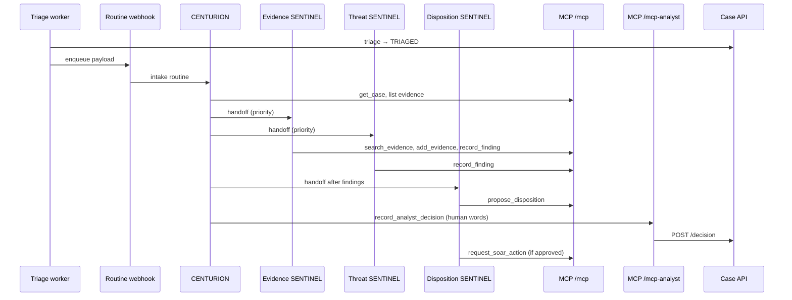

# LEGION bots

LEGION is the Grok Bot SOC crew. Bot **skills** live outside this repository; bots call the Case API only through MCP.

## Roles

| Bot | Role |
| --- | --- |
| **CENTURION** | Case intake from routine webhook, coordinates investigation, records analyst approve/reject via `/mcp-analyst` |
| **Evidence SENTINEL** | Pulls Splunk evidence and attaches findings |
| **Threat SENTINEL** | Threat context and findings |
| **Disposition SENTINEL** | Proposes disposition; may `request_soar_action` only after approval |

## Routine trigger

When triage leaves a case in **`TRIAGED`** (not `AUTO_RESOLVED` or `NEEDS_REVIEW`), the worker POSTs JSON to the configured routine webhook. That starts CENTURION's **New case intake** routine. Auto-resolved cases and duplicate skips do not enqueue.

Required env (names only): `ROUTINE_WEBHOOK_ENABLED`, `ROUTINE_WEBHOOK_URL`, `ROUTINE_WEBHOOK_KEY`.

## Handoff flow

## Human approval steps

1. CENTURION surfaces disposition and asks the analyst to approve or reject in chat (HIGH/CRITICAL may prompt **Investigate now?** first).
2. Only CENTURION calls `record_analyst_decision` on `/mcp-analyst` with verbatim `instruction_text` and provenance fields.
3. Case API requires `actor.type=analyst` on `POST /v1/cases/{id}/decision`.
4. Disposition SENTINEL checks case status is **`APPROVED`** before `request_soar_action` or `create_incident_ticket`.
5. `AUTO_RESOLVED` and unapproved paths cannot reach SOAR.