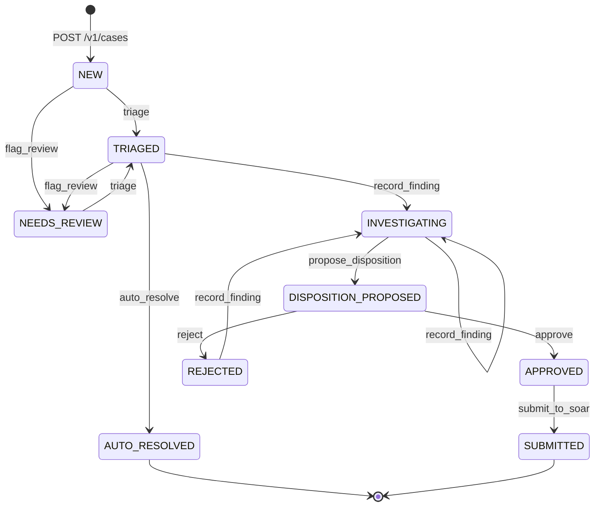

# Case API (`/v1`)

Business rules live in `services/case_api/service.py`. Routes in `routes.py` parse input, call `CaseService`, and map `CaseError` to HTTP. The transition table is the pure dict `TRANSITIONS` in `state.py`.

## Endpoints

| Method | Path | Body (JSON) | Success | Typical errors |
| --- | --- | --- | --- | --- |
| `GET` | `/v1/cases` | — | `200` `CaseList` (query: `status`, `severity`, `alert_id`, `limit`, `offset`) | `422` pagination |
| `POST` | `/v1/cases` | `CaseCreate` (`alert_id`, `title`, `summary`, `splunk_severity`, `actor`, …) | `201` `Case` | `409` duplicate `alert_id`, `422` validation |
| `GET` | `/v1/cases/{case_id}` | — | `200` `Case` or expanded dict with `include` | `404`, `422` |
| `GET` | `/v1/cases/{case_id}` | query `include=evidence,findings,audit`, optional `audit_limit` | `200` object with requested sections | `404`, `422` |
| `POST` | `/v1/cases/{case_id}/triage` | `TriageCreate` (severity, rationale, route, rule, verdict, tokens, flags, `actor`) | `200` `Case` | `404`, `409` illegal transition, `422` |
| `POST` | `/v1/cases/{case_id}/auto-resolve` | `AutoResolveCreate` (`policy_id`, `triage_evidence_id`, `actor` system policy) | `200` `Case` | `403` wrong actor, `409` policy gate or transition, `422` |
| `POST` | `/v1/cases/{case_id}/review-flag` | `ReviewFlagCreate` (`reason`, `detail`, `actor`) | `200` `Case` | `404`, `409`, `422` |
| `GET` | `/v1/cases/{case_id}/evidence` | — | `200` list of `Evidence` | `404`, `422` |
| `POST` | `/v1/cases/{case_id}/evidence` | `EvidenceCreate` | `201` `Evidence` | `404`, `409` transition, `422` |
| `POST` | `/v1/cases/{case_id}/findings` | `FindingCreate` (`kind`, `statement`, `evidence_ids`, `actor`) | `201` `Finding` | `404`, `409`, `422` unknown evidence |
| `GET` | `/v1/cases/{case_id}/history` | — | `200` audit events | `404`, `422` |
| `POST` | `/v1/cases/{case_id}/disposition` | `DispositionCreate` (`action`, `rationale`, `finding_ids`, `actor`) | `201` `Disposition` | `404`, `409` conflict / transition, `422` |
| `POST` | `/v1/cases/{case_id}/decision` | `DecisionCreate` (`decision` approve\|reject, `rationale`, `actor` analyst, optional `source`) | `201` `Decision` | `403` non-analyst, `404`, `409`, `422` instruction mismatch |
| `POST` | `/v1/cases/{case_id}/soar-submission` | `SoarSubmitRequest` (`actor`) | `201` `SoarSubmission` | `404`, `409` duplicate / no approval, `422`, `502` SOAR down |
| `POST` | `/v1/cases/{case_id}/incident-ticket` | `IncidentTicketCreate` (optional `summary`, `actor`) | `200` or `201` `IncidentTicketResponse` | `403` system actor, `404`, `409` no approval, `422`, `502` |
| `GET` | `/v1/cases/{case_id}/view` | — | `200` `CaseView` | `404`, `422` |
| `GET` | `/v1/events` | query `after_id`, optional `case_id`, `limit` | `200` `EventPage` | `422` |
| `GET` | `/v1/metrics` | optional query `since` (ISO UTC) | `200` `Metrics` | `422` invalid timestamp |
| `GET` | `/healthz` | — | `200` `{status: ok}` | — |

Errors use `ErrorResponse`: `{ "error", "message", "details" }`.

## Error codes (from code)

| HTTP | `error` field | Meaning |
| --- | --- | --- |
| `409` | `illegal_transition` | Operation not allowed from current status (`TRANSITIONS`) |
| `409` | `policy_gate_failed` | Auto-resolve G1–G10 check failed (`details.failed`) |
| `409` | `no_analyst_approval` | SOAR or ticket without stored approve |
| `409` | `duplicate` / `conflict` | Duplicate alert, SOAR submit, or missing disposition |
| `403` | `forbidden` | Non-analyst on decide; wrong auto-resolve actor; system on ticket |
| `422` | `validation_error` | Request or domain validation failed |
| `422` | `instruction_mismatch` | Chat provenance text does not match decision word |
| `502` | `soar_unavailable` | Mock SOAR HTTP failure |

Rejected mutating calls (any 4xx) write **no** audit event.

## State machine (`TRANSITIONS`)

`add_evidence` is legal from `NEW`, `TRIAGED`, `INVESTIGATING`, `REJECTED`, `NEEDS_REVIEW` with **no status change**. `create_incident_ticket` is allowed in `APPROVED` and `SUBMITTED` without changing status (still requires stored approve).

## Policy gate G1–G10

Evaluated in `_policy_gate_failed` on auto-resolve. Any failure returns `409 policy_gate_failed`; no audit event is written.

| Id | Check |
| --- | --- |
| G1 | `AUTO_RESOLVE_ENABLED=1` |
| G2 | `case.route == "autonomous"` |
| G3 | `verdict` in `benign`, `false_positive` |
| G4 | `recommended_action` not in `escalate`, `contain` |
| G5 | triage severity in `low`, `medium` |
| G6 | Splunk severity at most `medium` |
| G7 | `privileged_account` is not true |
| G8 | `crown_jewel_asset` is not true |
| G9 | `confidence` ≥ `AUTO_RESOLVE_MIN_CONFIDENCE` (default `0.8`) |
| G10 | `triage_evidence_id` references this case's `triage_assessment` evidence row |

## Approval and SOAR rules

- **Decide** (`POST .../decision`): only `actor.type == "analyst"`. Optional `source.instruction_text` must contain the decision word (`approve` / `reject`).
- **SOAR submit**: requires `APPROVED`, open disposition, stored `approve` decision, and legal transition to `SUBMITTED`. `AUTO_RESOLVED` cannot submit.
- **Incident ticket**: forbidden for `actor.type == "system"`; requires `APPROVED` or `SUBMITTED` with stored approve; blocked for `TRIAGED`, `REJECTED`, `AUTO_RESOLVED`.
- **Auto-resolve actor lock**: `actor` must be `type=system`, `id=policy:autonomous-triage`, and `policy_id=autonomous-triage`.
- **Kill switch**: `AUTO_RESOLVE_ENABLED` default `0` (gate G1).