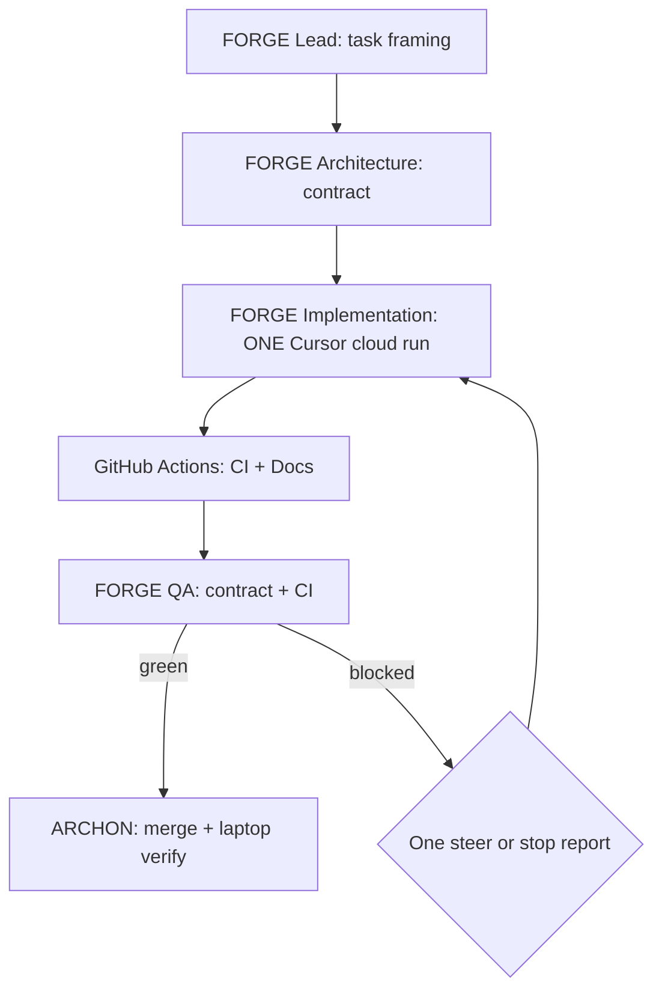

# How to contribute

Welcome, weary traveler. You’ve found the CONTRIBUTING guide for **forge-legion**.

**Open an issue?** No — talk to **FORGE Lead**.  
**Drive-by refactors?** No — talk to **FORGE Architecture** (they write contracts, not code).  
**“Just one more relaunch”?** No — you get **one steer**.

This repo was built like an open-source project that forgot it’s a demo SOC: contracts, CI, and humans who merge.

## Roles (who does what)

| Role | Job | Touches git? |
| --- | --- | --- |
| **FORGE Lead** | Frames the next task: scope, budget, stop rule, model pin | No |
| **FORGE Architecture** | Writes the contract (`contracts/C*-contract.md`) — scope, files, tests, out of scope | No code |
| **FORGE Implementation** | **One** Cursor cloud agent run (pinned **composer-2.5**, no max mode) | Yes — one PR |
| **FORGE QA** | Green or blocked vs contract + CI; at most **one** QA retry | Comments / steer |
| **ARCHON** | Merges green PRs; verifies on the laptop with Make targets from the contract | Merge to `main` |

LEGION bots are not contributors. They consume MCP; they do not edit this tree.

## The FORGE loop



**Green:** ARCHON merges. **Blocked:** one steer back to the same PR (same branch), or a stop report — not a fresh relaunch parade.

## What a contract contains

Every `contracts/C*-contract.md` is the law for one implementation run. Typical sections (names vary by C-number):

| Section | Purpose | Example location |
| --- | --- | --- |
| **Scope / design decisions** | What we are building and why | C1 `§0`, C3 `§0` |
| **Files** | Allowed layout; what may change | C1 `§5`, C4 `§6` |
| **Models, endpoints, env** | APIs, Pydantic shapes, env **names** | C1 `§1–3`, C5 `§4` |
| **Tests** | Named pytest cases = acceptance | C1 `§6`, C3 `§7` |
| **Out of scope** | Explicit non-goals | C1 `§7`, C8 out-of-scope blocks |
| **Budget / stop rule** | Run cost cap; halt if VM blocked (e.g. no Docker) | C3 `§8`, C7 `§3 STOP RULE` |
| **Laptop verification** | ARCHON commands after merge | C6 `§7` |

Read the contract before you touch code. If it isn’t in the contract, it isn’t in the PR.

## Architecture guardrails (from `.cursor/rules/architecture.mdc`)

Summarized from the rule file only:

1. Business rules live only in `services/case_api/service.py` (transitions, approvals, duplicates, audit). Bots and UIs call the API; they do not decide state.
2. `TRANSITIONS` + `check_transition()` live in `services/case_api/state.py` — pure, no I/O.
3. Each mutating call is one SQLite transaction; audit commits with state; **4xx writes no audit event**.
4. `routes.py` parses, calls service, maps errors — no business rules.
5. `CaseService` takes store + `SoarClient` by injection; `app.py` is a factory.
6. **`/v1` is additive only** — no removed or renamed fields, statuses, or paths; breaking changes go to `/v2`.
7. `state.py` / service / routes stay independently testable.
8. Mock Splunk is read-only plus reset/replay; no case logic; no Case API writes.
9. New Splunk sources: C2 contract §4 only (one module, one fixture, one registry line).
10. Triage uses HTTP to Splunk and Case API; routing in `config/routing.yaml` + `routing.py`; model `recommended_route` is advisory.
11. MCP adapter: one tool = one Case API call; no approve/reject on `/mcp`; adapter must not import `services.case_api`.
12. Mock SOAR owns idempotency on `case_id`; never calls back into Case API.

## CI gates (real job names)

Pull requests run **`.github/workflows/ci.yml`** (workflow name: **CI**):

| Job | What it does |
| --- | --- |
| `ruff` | Lint |
| `mypy` | Strict typing on `services` and `contracts` |
| `scenarios-check` | `make scenarios-check` on scenario YAML |
| `pytest` | Full suite, then again with `.env.example` only |
| `openapi` | `python scripts/export_openapi.py --check` |
| `boot-smoke` | Compose health, seed triage, public MCP port, console, stream/metrics, reset |

Docs changes also run **`.github/workflows/docs.yml`** (workflow name: **Docs**):

| Job | What it does |
| --- | --- |
| `build` | `mkdocs build --strict` |
| `deploy` | GitHub Pages publish on push to `main` only |

No merge on red. QA is not optional color commentary.

## House rules

1. **One implementation run at a time** per contract — composer-2.5 unless the contract says otherwise.
2. **Steer, don’t relaunch** — fix the same PR; at most **one QA retry**.
3. **`/v1` additive only** (see architecture rule 6).
4. **No secrets in git** — env var names in docs and `.env.example`; values in `.env.local` only.
5. **Demo-facing text** — no “test”, “mock”, or “fixture” wording where the audience thinks it’s production Splunk/SOAR (README and console copy follow this; code paths may still say `mock_splunk`).

## Contracts → pull requests

Titles are from GitHub (as merged on `main`).

| Contract | PR(s) | Description |
| --- | --- | --- |
| C1 | [#2](https://github.com/vihag/forge-legion/pull/2) | feat(C1): case store and case API v1 |
| C2 | [#3](https://github.com/vihag/forge-legion/pull/3) | feat(C2): mock splunk v1 and C1 follow-ups |
| C3 | [#18](https://github.com/vihag/forge-legion/pull/18), [#20](https://github.com/vihag/forge-legion/pull/20) | feat(C3): langgraph triage; test(C3): real Grok recording for seed fixture |
| C4 | [#21](https://github.com/vihag/forge-legion/pull/21) | feat(C4): mock SOAR and MCP adapter |
| C5 | [#23](https://github.com/vihag/forge-legion/pull/23) | feat(C5): compose deploy, gateway, ngrok profile, and boot-smoke CI |
| C6 | [#26](https://github.com/vihag/forge-legion/pull/26) | C6: analyst decisions MCP, Splunk read tools, public gateway |
| C7 | [#29](https://github.com/vihag/forge-legion/pull/29), [#33](https://github.com/vihag/forge-legion/pull/33) | feat(C7): SOC Command Center + data-driven alert stream; fix(C7): live stream alert time + metrics_check severity key |
| C8 | [#32](https://github.com/vihag/forge-legion/pull/32), [#35](https://github.com/vihag/forge-legion/pull/35) | feat(C8): routine webhook, script timing, HITL rotation, incident ticket, get_case include; feat(stream): script mode plays demo_script.yaml + make stream-script |
| C9 | [#41](https://github.com/vihag/forge-legion/pull/41) | C9: docs site on GitHub Pages |
| C9b | [#43](https://github.com/vihag/forge-legion/pull/43) | C9b: design docs pages *(merged)* |
| C10 | [#45](https://github.com/vihag/forge-legion/pull/45) | C10: Langfuse tracing (opt-in) |
| C10b | *(this PR)* | C10b: docs refresh for Langfuse tracing |

Evidence-only fixes that landed beside C8:

| PR | Description |
| --- | --- |
| [#38](https://github.com/vihag/forge-legion/pull/38) | fix(splunk): evidence never post-dates the alert (hero restamp + stream) |
| [#39](https://github.com/vihag/forge-legion/pull/39) | fix(splunk): hero evidence matches its alert; searches return every hero record |

## Real lessons (from merged diffs)

**#20 — record reality, not hand-waved JSON.** The seed triage fixture was replaced with a live Grok chat-completions recording. The recording’s top-level `"model"` is **`grok-4.3`** while the client still requests **`grok-3-mini`** (`services/triage/config.py` default). Triage stores **both** `model_requested` and `model_returned` (see `tests/triage/test_graph.py` assertions on `grok-4.3`). Trust the served model field, not the request string alone.

**#38 — time travel is cheating.** Evidence timestamps must never post-date the alert; stream and hero paths were adjusted so demo timelines stay causal.

**#39 — hero coherence.** Hero Splunk evidence must match its alert; search windows must return every hero record the narrative depends on.

## Before you push

```bash
pip install -r docs/requirements.txt
python3 -m mkdocs build --strict
```

More architecture detail: [FORGE build loop](forge.md), [Trust](trust.md).

*Maintained by FORGE. ARCHON merges; you steer.*