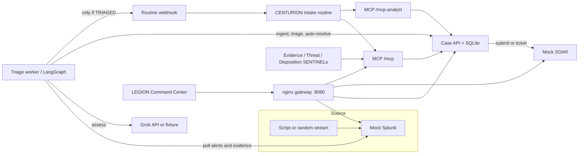
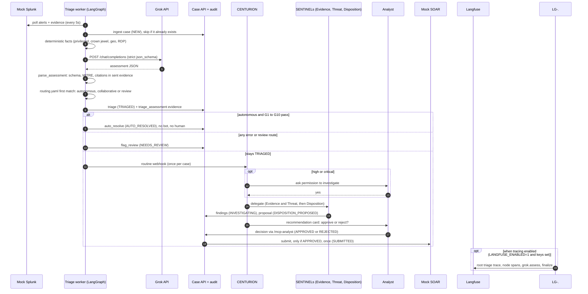

# Overview

**FORGE** built this repository with Cursor cloud agents against written contracts. **LEGION** is the live agentic SOC: CENTURION and three SENTINEL bots investigate cases through MCP while humans approve consequential actions.

## Three design rules

1. **The Case API owns state** — transitions, policy gates, duplicate guards, and audit events live only in `services/case_api/service.py`. Everything else calls HTTP.
2. **Grok infers; policy routes** — LangGraph calls Grok for assessment, but `config/routing.yaml` picks `autonomous`, `collaborative`, or `review`. The model's `recommended_route` is advisory.
3. **Humans approve anything consequential** — disposition approve/reject requires `actor.type=analyst`. SOAR submit, incident tickets, and auto-resolve policy failures cannot bypass stored approval.

## Component diagram

## End-to-end flow (trigger to SOAR)

One alert, every hop. Solid arrows are code paths; the human is the only actor that can approve.

## Stack (in-repo components)

| Component | Role | Package path |
| --- | --- | --- |
| Mock Splunk | Read-only alerts and evidence; reset, replay, stream | `services/mock_splunk/` |
| Triage worker | Polls alerts, runs LangGraph per alert | `services/triage/worker.py` |
| LangGraph triage | Ten-node graph: ingest, evidence, Grok, route, persist | `services/triage/graph.py` |
| Grok client | Live HTTP or fixture client | `services/triage/grok.py` |
| Routing policy | First-match rules from YAML | `config/routing.yaml`, `services/triage/routing.py` |
| Case API + SQLite | System of record for cases and audit | `services/case_api/`, `db/schema.sql` |
| MCP adapter | `/mcp` (11 tools) and `/mcp-analyst` (1 tool) | `services/mcp_adapter/` |
| Routine webhook | POST when status is `TRIAGED` | `services/triage/webhook.py` |
| Mock SOAR | Idempotent SOAR submissions and tickets | `services/mock_soar/` |
| LEGION Command Center | Static console polling metrics | `console/` via nginx `/console/` |
| nginx gateway | Default port 8080: `/case/`, `/splunk/`, `/soar/`, `/mcp`, `/console/` | `deploy/nginx/` |

Public exposure (optional ngrok profile) serves **MCP only** on the public gateway port; Case, Splunk, SOAR, and console stay on the local gateway.

Optional Langfuse tracing for the triage worker is documented in [Observability](observability.md) (`LANGFUSE_ENABLED=1` plus `LANGFUSE_PUBLIC_KEY`, `LANGFUSE_SECRET_KEY`, and `LANGFUSE_HOST` in `.env.local`).