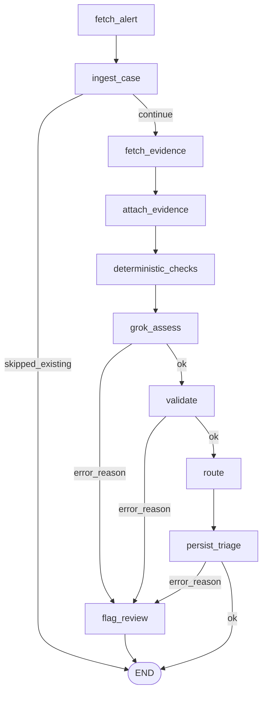

# LangGraph triage

The worker in `services/triage/worker.py` polls Mock Splunk and invokes `run_triage` in `graph.py` for each new alert.

## Graph (10 nodes)

## Nodes

| Node | Purpose |
| --- | --- |
| `fetch_alert` | `GET` alert from Mock Splunk |
| `ingest_case` | `POST /v1/cases`; duplicate past `NEW` → `skipped_existing` |
| `fetch_evidence` | List Splunk evidence for the alert |
| `attach_evidence` | Attach missing evidence rows to the case |
| `deterministic_checks` | Privileged account, crown-jewel host, geo, RDP (`checks.py`) |
| `grok_assess` | Grok chat completion → raw JSON |
| `validate` | `parse_assessment` → `GrokAssessment` |
| `route` | First-match `decide()` from `routing.yaml` |
| `persist_triage` | Store assessment evidence, `triage` case, optional `auto_resolve` |
| `flag_review` | Failure evidence + `review-flag` → `NEEDS_REVIEW` |

## `TriageState` fields

`alert_id`, `alert`, `case`, `skipped_reason`, `splunk_evidence`, `evidence_map`, `facts`, `grok_raw`, `assessment`, `route`, `rule`, `error_reason`, `error_detail`, `outcome`, `model_requested`, `model_returned`, `response_id`.

`error_reason` is one of: `model_call_failed`, `invalid_model_output`, `no_route_matched`.

## Grok client (`grok.py`)

| Setting | Value in code |
| --- | --- |
| Model | `XAI_MODEL`, default `grok-3-mini` (`config.py`) |
| Temperature | `0` (`HttpGrokClient`) |
| Response format | `json_schema` with `strict: True` and `GrokAssessment` schema |
| HTTP timeout | `30.0` seconds |
| Retries | Up to **2** attempts on timeout or HTTP ≥500 (`_post_with_retry`); the 2nd attempt has no backoff; 4xx is not retried |

Fixture modes: `GROK_CLIENT=fixture` with file or stream template registry (`StreamFixtureGrokClient`, `FixtureGrokClient`).

## `parse_assessment` validation

- Content must be JSON object satisfying `GrokAssessment`
- Each `mitre_techniques` entry must match `^T\d{4}(\.\d{3})?$`
- Every `evidence_references` entry must exist in the attached evidence map

Failures set `error_reason` to `invalid_model_output` or `model_call_failed`.

## Worker loop

- Poll interval: `TRIAGE_WORKER_POLL_S` (default `5`)
- Concurrency: `TRIAGE_WORKER_CONCURRENCY` must be `1` or `2`
- After triage, `handle_triage_result` re-reads the case; webhook fires only when `status == TRIAGED`

## Routine webhook (`webhook.py`)

| Setting | Behavior |
| --- | --- |
| Active when | `ROUTINE_WEBHOOK_ENABLED=1` and non-empty `ROUTINE_WEBHOOK_URL` and `ROUTINE_WEBHOOK_KEY` |
| Default | Off (`ROUTINE_WEBHOOK_ENABLED` default `0`) |
| Payload keys | `case_id`, `alert_id`, `severity`, `route`, `rule` |
| Auth | `Authorization: Bearer` + value from `ROUTINE_WEBHOOK_KEY` |
| Timeout | `5.0` seconds per attempt |
| Attempts | **4** max |
| Backoff | **1s, 2s, 4s** between retries on 429, ≥500, or transport errors; other 4xx are not retried |

Delivery is in-process (queue + daemon thread); URL and key are not logged.

## Tracing

When gated on, the worker wraps each alert in one Langfuse trace named `triage` (`services/triage/tracing.py:triage_with_trace`, 250–296; root span in `tracing_langfuse.py:trace_alert`, 74–98). LangGraph nodes run inside child spans named after the node (`graph.py` wraps each `add_node` at 351–376 via `node_span`, 357–360). The Grok HTTP call adds a generation observation `grok.assess` under `grok_assess` with prompt input `{"user_message": ...}` (`graph.py:grok_assess`, 137–140; `tracing_langfuse.py:generation_span`, 126–141). After routing and optional auto-resolve, `finalize` records route/outcome tags and metadata (`tracing_langfuse.py:finalize`, 161–198).

| Score | Emitted when | Code |
| --- | --- | --- |
| `assessment_confidence` | Case has a stored confidence and outcome is not `skipped_existing` | `tracing.py:triage_with_trace` (295–296); `tracing_langfuse.py:finalize` (182–187) |
| `auto_resolve_gate` | Policy route tag is `autonomous` (`1` if gate `pass`, else `0` with rule in comment) | `tracing_langfuse.py:finalize` (188–198) |

**Opt-in gate:** tracing runs only when `LANGFUSE_ENABLED=1` and `LANGFUSE_PUBLIC_KEY`, `LANGFUSE_SECRET_KEY`, and `LANGFUSE_HOST` are all non-empty (`tracing.py:_gating_disabled_reason`, 26–39); otherwise `NoopTracer` is used. The Langfuse SDK loads lazily via `importlib` only after the gate passes (`tracing.py:build_tracer`, 174–185). Import or runtime errors log and fall back to no-op — triage outcomes are unchanged (`tracing_langfuse.py:_rate_limited_error`, 38–47 disables after 5 errors in the worker process (the counter is not reset on success)).

Setup and shutdown: [Observability](observability.md).